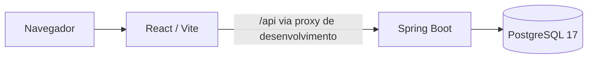

# Arquitetura inicial

O Finora é um monorepo com dois projetos independentes. O frontend React entrega a interface no navegador; o backend Spring Boot evoluirá como uma API REST; o PostgreSQL é o banco transacional. O Compose integra os serviços para desenvolvimento.

A API de negócio ainda não existe. Somente `/actuator/health` é público; todos os outros caminhos estão bloqueados. Não há autenticação, entidades financeiras, migrations de negócio ou multi-tenancy implementados.

## Monólito modular

O backend começará como monólito modular: menor custo operacional e transações locais, sem a complexidade prematura de microsserviços. Novos módulos devem ser organizados por capacidade de negócio dentro de `br.com.finora`, mantendo regras de domínio fora dos controllers. Hoje existem somente configuração de segurança e tratamento comum de validação.

Spring Boot 3.5 e Java 17 atendem ao requisito inicial. Spring Data JPA fornece persistência, Validation valida entradas e Flyway versionará mudanças de schema. `ddl-auto=validate` impede alterações implícitas pelo Hibernate. Lombok está disponível para futuros modelos; a base atual não necessita de classes artificiais para utilizá-lo.

O frontend separa rotas, páginas, layouts, componentes, serviços e estilos. React Router controla navegação; Axios centraliza futuras requisições; Tailwind 4 é integrado diretamente ao Vite. Diretórios adicionais serão criados quando houver código que justifique sua existência.

## Estratégia futura de multi-tenancy

Antes das entidades financeiras, avaliar schema compartilhado com `tenant_id` obrigatório versus schema separado por empresa. A decisão deve considerar escala, custo, backup, obrigações de privacidade e migrações. Não há isolamento garantido nesta etapa porque nenhuma funcionalidade multiempresa foi implementada.

O identificador da empresa deverá vir de contexto autenticado e autorizado, nunca ser aceito como autorização apenas por aparecer em um header ou corpo. Cada consulta, índice único, relacionamento, cache e tarefa assíncrona deverá preservar o contexto da empresa. Planejar testes negativos de acesso entre tenants e considerar Row Level Security como defesa adicional no PostgreSQL.

## Segurança e operação

Não existem usuários padrão nem JWT provisório. CSRF permanece habilitado. Informações de erro e de health não incluem segredos ou detalhes do banco. O frontend não carrega segredos em `VITE_*`. A rede do banco é interna e suas portas locais estão no loopback.

O profile de testes usa H2, adequado à inicialização sem schema de negócio. Ao criar queries ou migrations, adicionar testes PostgreSQL reais, preferencialmente com Testcontainers. O Compose permite validar desde já o startup real com PostgreSQL e Flyway.

Não existe infraestrutura de produção. Avaliar atualização da linha Spring Boot, suporte das dependências, autenticação, logs auditáveis, observabilidade, TLS, backups e estratégia de deploy antes de disponibilizar o SaaS.
