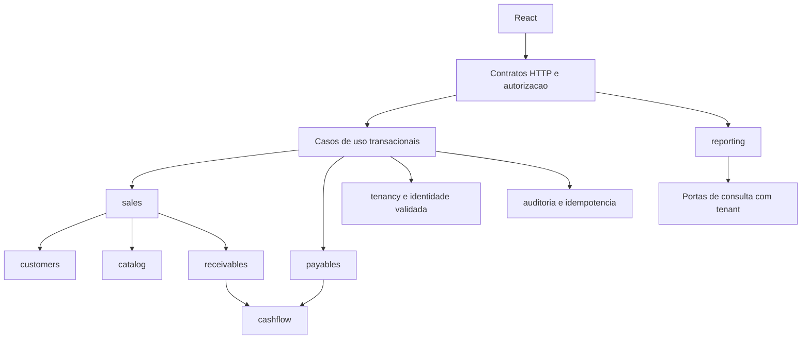

# Monólito modular proposto

Mantém a base existente: Java 17/Spring Boot 3.5, uma aplicação backend e PostgreSQL; React separado. Nenhum pacote ou classe será criado nesta fase. Nomes abaixo são fronteiras futuras, não diretórios vazios a preencher.

| Módulo | Responsabilidade / dados próprios | Dependências permitidas |
| --- | --- | --- |
| identity | AppUser, autenticação/sessão futura | tenancy por porta de consulta de memberships, sem dependência circular de implementações |
| tenancy | Tenant, TenantMembership, TenantSettings, contexto/permissões | Identificadores e porta de identidade; provisioning coordenado por aplicação |
| customers | Customer e histórico cadastral | tenancy |
| catalog | Product e snapshots consultáveis | tenancy |
| sales | Sale/SaleItem, total comercial, confirmação/cancelamento | customers/catalog por portas públicas; receivables por comando de aplicação |
| receivables | Receivable, parcelas, baixas e reversões de recebimento | tenancy, finance-reference, cashflow por porta de gravação na mesma transação |
| payables | Payable e suas baixas/reversões | tenancy, finance-reference, cashflow por porta de gravação |
| finance-reference | PaymentMethod, FinancialCategory e referência de conta | tenancy; conta é propriedade de cashflow |
| cashflow | CashAccount, CashMovement e saldo realizado | tenancy; aceita fatos tipados dos módulos financeiros, não chama sales de volta |
| reporting | Consultas de dashboard/conciliação/projeções futuras | Portas de consulta dos módulos ou read models SQL tenant-scoped documentados |
| audit | AuditEvent e política de redação | Identificadores e contexto; sem regras financeiras próprias |

PaymentReversal fica logicamente junto à liquidação: esquema comum proposto, com serviços de reversão de receivables/payables e exclusão mútua das referências. IdempotencyRecord é infraestrutura de aplicação, sem tornar cashflow dono de vendas ou de usuários.

## Comunicação e dependências

Interfaces públicas de aplicação trocam comandos, resultados e IDs, não entidades JPA nem repositórios de outro módulo. Evitar ciclo identity↔tenancy com contratos pequenos e composição no caso de uso. Não adicionar barramento de eventos, Kafka, RabbitMQ ou microsserviços para realizar gravações que precisam de atomicidade local.

## Transações e consistência

O caso de uso orquestrador delimita a transação Spring. Confirmar venda chama a criação de recebível na mesma transação; registrar baixa chama a gravação de caixa e auditoria na mesma transação. Não publicar evento assíncrono como única garantia de que uma baixa virou caixa. Uma exceção provoca rollback integral; falha de entrega HTTP após commit é resolvida por idempotência, não repetição cega.

Locks/versionamento seguem RN-012; ordem de aquisição é determinística. Consultas de dashboard devem usar recorte coerente (snapshot de leitura transacional quando necessário) para não misturar saldos de antes/depois da mesma baixa. Projeções financeiras da API têm data de corte e não escrevem no histórico de caixa.

## Organização futura de cada módulo

Separar domain (invariantes/valores), application (casos de uso/transações/portas), infrastructure (JPA/integrações) e api (controllers/DTOs). Aplicar essa separação onde houver responsabilidade real; não criar quatro camadas de pass-through para um cadastro simples. DTOs de request/response são próprios, nomes em inglês, textos de interface/erros em português. Java packages em minúsculas; UUID como ID de recurso; tabelas snake_case; enums estáveis e traduzidos na UI.

Validação de formato ocorre na fronteira (Bean Validation); autorização e regras de saldo dentro da transação; constraints complementam integridade no banco. Nenhuma entidade JPA deve ser serializada diretamente, principalmente por conter tenant/custos/documentos/relacionamentos não autorizados.

## Erros e auditoria

Erros seguem Problem Details com code/traceId e violações de campo seguras; nunca stack trace, SQL ou UUID de outro tenant. 409 representa conflito de saldo/versão/idempotência; não capturar toda exceção financeira como 200 com mensagem de erro.

AuditEvent registra ator, tenant, recurso, horário, operação e motivo. Auditoria de sucesso integra o commit financeiro. Tentativas negadas podem ir para log de segurança redigido; não gravar “sucesso” em transação separada que sobreviva ao rollback. [ADR-006](decisions/006-auditoria.md) delimita histórico e retenção.

Os testes futuros verificam fronteiras de módulo, contratos públicos, invariantes A–G, isolamento PostgreSQL e rollback. Os pipelines atuais permanecem inalterados nesta fase documental.
