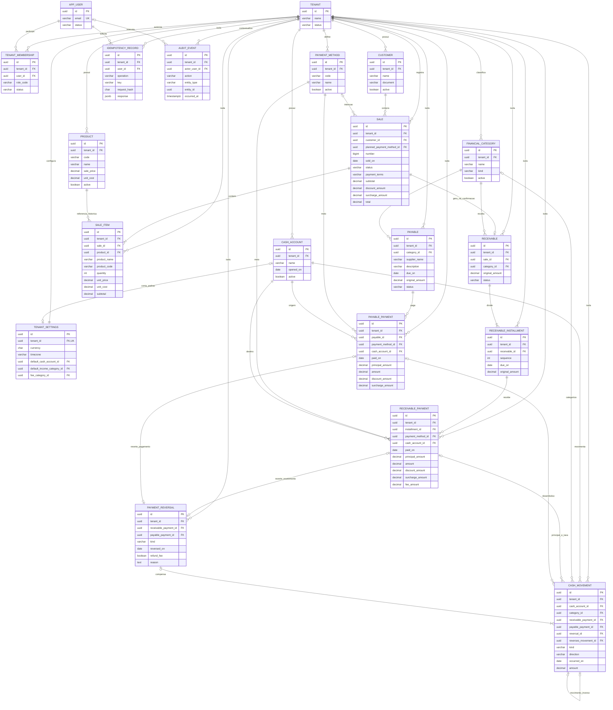

# Modelo entidade-relacionamento proposto

Modelo lógico para revisão, **não schema implementado**. Tipos, nulabilidade, regras e índices estão no [dicionário](data-dictionary.md); sem SQL executável ou migrations. Referência semântica: [RN-001–017](business-rules.md).

Os nomes de domínio em inglês correspondem a tabelas futuras em snake_case. `AppUser` evita usar o nome SQL reservado User; é identidade global. `Role` será inicialmente um código fixo em TenantMembership, não uma tabela/editor de permissões. `PaymentMethod` representa meio realizado; crediário é Sale.payment_terms. `PayableInstallment` foi adiado: o MVP usa um título de despesa por vencimento, com vários pagamentos parciais.

## Leitura e limites do diagrama

- PK UUID em todas as entidades. Nas entidades tenant-scoped, a unicidade adicional `(tenant_id, id)` permite FKs compostas para **toda referência de negócio**, inclusive reverses_movement_id e defaults de settings. Uma FK isolada por UUID não basta para essa segurança.
- Sale → Receivable é opcional no desenho para DRAFT; confirmação exige exatamente um título com soma de parcelas igual ao total. Não se deixa venda CONFIRMED sem título por ser opcional no ER.
- Cada PaymentReversal aponta a **uma e somente uma** baixa; as duas relações opcionais representam uma exclusão mútua, não a permissão de preencher ambas.
- CashMovement usa fontes tipadas exclusivas; uma abertura não tem pagamento, uma taxa compartilha a baixa de recebimento e uma reversão aponta ao PaymentReversal e ao movimento inverso original. O diagrama não substitui as constraints por kind.
- Dados comuns de criação/versionamento foram omitidos do desenho para legibilidade, mas estão no dicionário. AuditEvent é técnico: tenant pode faltar somente em evento global de identidade; finanças e auditoria de negócio sempre carregam tenant.
- Campos de saldo/atraso/quitação/restituição são projeções, não colunas monetárias editáveis. Não há tabela de assinatura, estoque, fornecedor ou autenticação escolhida implicitamente.
